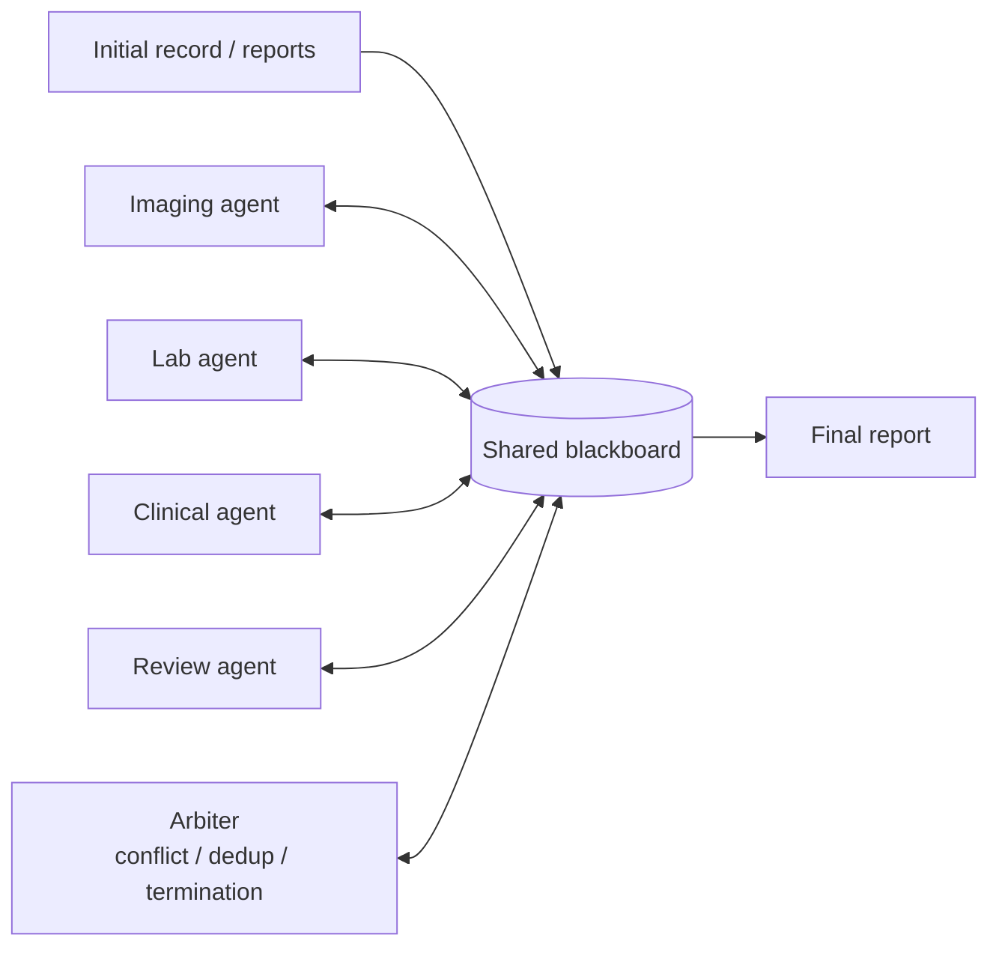

# Blackboard Shared Architecture


Companion code for the article "[Multi-Agent Architecture Explained: Blackboard Shared Architecture](https://blog.csdn.net/qq_67069922/article/details/171035456)". The article explains the pattern but doesn't ship a runnable implementation, so this repo fills that gap and adds conflict resolution and termination detection.

## Overview

The main difference from pipelines, star topologies, and hierarchies is that nobody assigns work. Agents don't message each other; they all watch one shared blackboard and add a note when they see something in their area. Participation is driven by board state, not a schedule built in advance.

The code deals with four things:

- Structured storage: notes, evidence, hypotheses, conflicts, and conclusions live in separate fields instead of one blob.
- Append-only writes: every item has an id and references, so a conclusion can be traced back through the chain.
- Conflict handling: two different claims about the same subject get recorded automatically. Three strategies are available: highest confidence, latest write, second review.
- Termination: the run converges after several quiet rounds with no open conflicts. A round cap and a conflict fallback keep it from spinning forever.

The demo is a multidisciplinary consultation. The intake agent seeds the board with the history, ultrasound report, and lab result. The imaging and lab agents add evidence and disagree about the cause. The arbiter records the conflict, the review agent decides after reading all the evidence, and the summary agent writes the report.



A run takes five rounds: imaging and lab join in round 1, clinical assessment and review run together in round 2, summary writes the report in round 3, rounds 4 and 5 are quiet, then the run stops.

## Dependencies

Standard library only. Concurrency uses `concurrent.futures`, data structures use `dataclasses`, locking uses `threading`, and tests use `unittest`. Python 3.9 or newer, because the code uses built-in generics such as `list[str]`.

## Project structure

```
blackboard-shared-architecture/
├── blackboard_architecture.py        # blackboard, arbiter, agents, runtime, consultation demo
├── test_blackboard_architecture.py   # tests for dedup, triggers, arbitration, termination, concurrency
├── readme.md                         # English documentation
├── readme_CN.md                      # Chinese documentation
└── .gitignore
```

Key classes:

| Class / function | Role |
| --- | --- |
| `BoardItem` | Immutable item with author, kind, subject, value, confidence, references |
| `Blackboard` | Thread-safe shared space for append, dedup, filtering, versioning |
| `Conflict` | Conflict record with a dedup signature built from the subject and claims |
| `Arbiter` | Conflict detection, three strategies, fallback ruling, termination |
| `ExpertAgent` | Base agent that only defines activation and output |
| `BlackboardRuntime` | Scheduling loop, concurrent execution, audit log, convergence control |
| `build_demo` | Builds the multidisciplinary consultation scenario |

## Usage

Run the demo:

```bash
python blackboard_architecture.py
```

The terminal prints who joined each round and what was written, then the full board, the report, the stop reason, and the elapsed time.

Run the tests:

```bash
python -m unittest -v test_blackboard_architecture.py
```

To add a scenario, subclass `ExpertAgent`:

```python
from blackboard_architecture import Blackboard, ExpertAgent, BlackboardRuntime;

class RiskAgent(ExpertAgent):
    # Adds a risk assessment once transaction data shows up.
    name = "Risk agent";

    def should_activate(self, board):
        # Contribute when transactions exist and this agent has not spoken yet.
        return board.has(subject="Transactions") and not board.has(author=self.name);

    def act(self, board):
        # Return the items to write; the runtime fills in the author.
        return [
            {
                "kind": "hypothesis",
                "subject": "Risk level",
                "value": "Medium-high",
                "confidence": 0.72,
                "tags": ("risk",),
            },
        ];

board = Blackboard();
board.write(author="Gateway", kind="note", subject="Transactions", value="12 cross-province transfers in 10 minutes", confidence=0.9);
runtime = BlackboardRuntime(board, [RiskAgent()]);
runtime.run();
print(board.render());
```

Switch arbitration by passing `Arbiter("最高置信度")` or `Arbiter("最新写入")`. For a real LLM setup, replace `act` with a model call; the rest of the framework stays unchanged.

## Contributing

Open an issue and say whether the task is open-ended judgment or a fixed process. The latter is usually better handled by a pipeline. Run the tests before sending a pull request. Keep the code in one module and avoid third-party dependencies.

## Contact

Ailan Anjuxi

- 📫 Email: anjuxi.ME@outlook.com

- 📞 SIP: sip:anjuxi@sip.linphone.org

  

> © 2026 谙弆悕博士（Ailan Anjuxi），All rights reserved.
