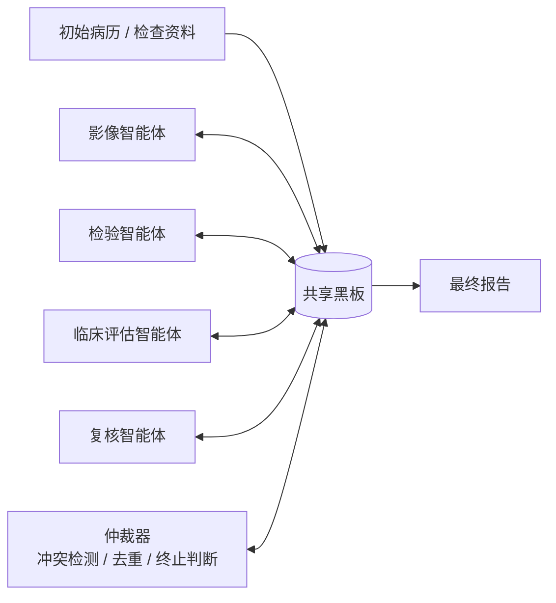

# 黑板共享架构


读完[《多智能体架构详解：黑板共享架构（共享存储交互型）》](https://blog.csdn.net/qq_67069922/article/details/171035456)之后写的配套代码。博客把思路讲清楚了，但没给能直接跑的完整实现，这里补一个，顺手把冲突消解和终止判断也做了。

## 项目介绍

黑板架构跟流水线、星型、层级最大的不同是没人派活。智能体之间不互相发消息，都盯着一块公共黑板，看到有自己能处理的信息就写一笔，没看到就等下一轮。参与顺序不是提前排的，是黑板状态触发的。

代码里主要处理四件事：

- 黑板做结构化存储，证据、假设、冲突、结论分开字段放，不塞成一大段文本。
- 入库只追加不修改，每条记录带编号和引用，出问题能顺着编号往回查。
- 同一个主体出现不同说法时自动登记冲突，支持最高置信度、最新写入、二次复核三种处理方式。
- 连续几轮没有新增、冲突也都解决了就收敛；另外留了轮次上限和冲突兜底，防止停不下来。

示例是多学科会诊。接诊智能体先把病历、超声和化验单写进黑板，影像和检验各自补证据、给判断，两边说法对不上时仲裁器记一笔冲突，复核智能体看完所有证据再裁决，最后汇总成报告。



实际跑起来是五轮：第 1 轮影像和检验同时进场，第 2 轮临床评估和复核并发参与，第 3 轮汇总出报告，第 4、5 轮黑板没动静，判定收敛。

## 依赖说明

只用标准库。并发用 `concurrent.futures`，数据结构用 `dataclasses`，加锁用 `threading`，测试用 `unittest`。Python 3.9 以上即可，代码里用了 `list[str]` 这种写法。

## 项目结构

```
黑板共享架构/
├── blackboard_architecture.py        # 黑板、仲裁器、智能体、运行时和会诊示例
├── test_blackboard_architecture.py   # 去重、触发、仲裁、终止和并发的测试
├── readme.md                         # 英文说明
├── readme_CN.md                      # 中文说明
└── .gitignore
```

几个核心类：

| 类 / 函数 | 干什么 |
| --- | --- |
| `BoardItem` | 不可变条目，记写入方、类型、主体、内容、置信度和引用 |
| `Blackboard` | 线程安全的共享空间，负责追加、去重、筛选和版本号 |
| `Conflict` | 冲突记录，按主体和断言值生成去重签名 |
| `Arbiter` | 查冲突、三种裁决策略、兜底和终止判断 |
| `ExpertAgent` | 智能体基类，只定义触发条件和产出 |
| `BlackboardRuntime` | 调度循环、并发执行、审计日志和收敛控制 |
| `build_demo` | 组装多学科会诊场景 |

## 使用说明

跑演示：

```bash
python blackboard_architecture.py
```

终端会按轮次打印谁参与了、新写了什么，最后打出完整黑板和报告，以及终止原因和耗时。

跑测试：

```bash
python -m unittest -v test_blackboard_architecture.py
```

自己加场景，继承 `ExpertAgent` 就行：

```python
from blackboard_architecture import Blackboard, ExpertAgent, BlackboardRuntime;

class RiskAgent(ExpertAgent):
    # 风控智能体，看到交易流水后补一条风险判断。
    name = "风控智能体";

    def should_activate(self, board):
        # 有流水，而且自己还没说过话，就参与。
        return board.has(subject="交易流水") and not board.has(author=self.name);

    def act(self, board):
        # 返回想写的条目，author 由运行时填。
        return [
            {
                "kind": "hypothesis",
                "subject": "风险等级",
                "value": "中高风险",
                "confidence": 0.72,
                "tags": ("风控",),
            },
        ];

board = Blackboard();
board.write(author="接入层", kind="note", subject="交易流水", value="十分钟内跨省转账 12 笔", confidence=0.9);
runtime = BlackboardRuntime(board, [RiskAgent()]);
runtime.run();
print(board.render());
```

换仲裁策略就传 `Arbiter("最高置信度")` 或 `Arbiter("最新写入")`。想做真的大模型版本，把智能体的 `act` 换成模型调用，框架其余部分不用动。

## 贡献指南

遇到问题直接提 Issue，说清楚是开放式研判还是固定流程，后者其实用流水线更省事。提 PR 前先跑一遍测试。代码保持单文件，新功能尽量加在对应的类里，不引第三方依赖。

## 联系作者

谙弆悕博士（Ailan Anjuxi）

- 📫 邮箱：anjuxi.ME@outlook.com

- 📞 SIP 电话：sip:anjuxi@sip.linphone.org

  

> © 2026 谙弆悕博士（Ailan Anjuxi），All rights reserved.
